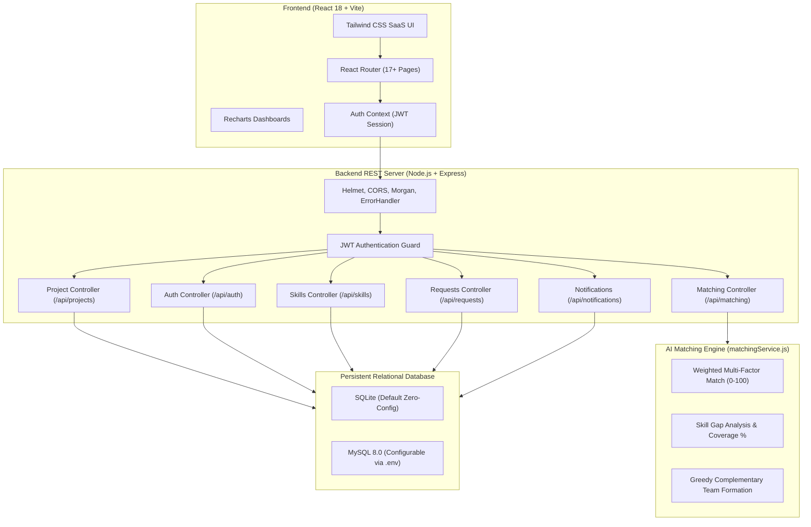

# SmartTeamFoundation — AI-Powered Smart Project Team Formation and Skill Matching System

[](https://nodejs.org/)
[](https://react.dev/)
[](https://vitejs.dev/)
[](https://tailwindcss.com/)
[](LICENSE)
[](docs/matching-algorithm.md)

---

## 1. Abstract

College engineering capstone projects, hackathons, and software engineering coursework require multidisciplinary, balanced student teams. Traditionally, students self-select teammates based on familiarity, resulting in teams with duplicate frontend skills, lacking backend/database developers, or suffering from mismatched availability and commitment.

**SmartTeamFoundation** is a full-stack web application and explainable AI skill-matching engine that intelligently pairs students with projects and discovers complementary teammates. The system analyzes technical competencies, proficiency levels, domain interests, preferred roles, and weekly availability to compute normalized compatibility scores, run real-time skill gap analysis, and generate greedy balanced team selections.

---

## 2. Problem Statement

In academic institutions and collaborative environments:
1. **Skill Clones & Imbalanced Rosters:** Students often team up with friends who possess identical skillsets (e.g., all UI designers or all beginner Python developers), leaving critical database, cloud, or ML roles uncovered.
2. **Subjective & Opaque Selection:** Project coordinators lack data-driven tools to evaluate whether a team has the necessary prerequisite competencies before project commencement.
3. **Availability Discrepancies:** Differing weekly time commitments cause friction and uneven workload distribution during sprint cycles.
4. **Lack of Explainability:** Many commercial matching solutions rely on opaque black-box embeddings that cannot explain *why* a student was recommended or *what* missing skills need to be filled.

---

## 3. Project Objectives

- **Explainable Skill Matching:** Develop a transparent multi-attribute scoring model (0–100%) with configurable weights evaluating skill overlap, proficiency, domain interest, role compatibility, experience, and weekly hours.
- **Dynamic Skill Gap Analysis:** Provide real-time visualization of covered, partially covered, and missing project skills, with candidate suggestions to fill those specific gaps.
- **Greedy Balanced Team Formation:** Implement a complementary team selection heuristic that prioritizes assembling diverse, balanced cohorts rather than clones.
- **Robust Role & Capacity Enforcement:** Prevent duplicate memberships, reject unauthorized alterations, and enforce project team-size limits on backend REST endpoints.
- **Dual-Database Support:** Out-of-the-box zero-configuration persistence via embedded SQLite alongside native enterprise MySQL 8.0 support.

---

## 4. Existing System vs. Proposed System

| Parameter | Existing System (Manual / Traditional) | Proposed System (SmartTeamFoundation) |
| :--- | :--- | :--- |
| **Team Formation** | Ad-hoc friend circles, manual spreadsheets, or random assignment. | Multi-factor explainable recommendation algorithm. |
| **Skill Assessment** | Unverified claims; no distinction between beginner and expert. | Granular proficiency tiers (Beginner, Intermediate, Advanced, Expert) with weighted satisfaction ratios. |
| **Skill Gaps** | Discovered late into the semester during deadlines. | Proactively identified in real-time on a dedicated Skill Gap Analysis dashboard. |
| **Team Synergy** | Often results in unbalanced teams with missing backend or DevOps roles. | Greedy complementary selection prioritizing uncovered project requirements. |
| **Workflow** | Disconnected emails and group chats. | Centralized application, invitation, role assignment, and notification workflow. |

---

## 5. Technology Stack

### Frontend
- **Framework:** React 18 (Vite build tool)
- **Styling:** Tailwind CSS (Professional SaaS Navy & Brand Blue design system)
- **Routing:** React Router v6 (17+ Modular pages & Protected Route Guards)
- **Icons:** Lucide React
- **Data Visualizations:** Recharts (Proficiency distribution bar charts, Skill gap donut charts)
- **HTTP Client:** Axios (Automated JWT Bearer token interceptor)

### Backend
- **Runtime:** Node.js v24 LTS
- **Framework:** Express.js REST API
- **Security:** `bcryptjs` (10 rounds password hashing), `jsonwebtoken` (JWT Session Management), `helmet`, `cors`
- **Testing:** Node.js native test runner (`node --test`)

### Database
- **SQLite (Default):** Built-in Node 24 `DatabaseSync` with zero native compilation dependencies, foreign keys enabled (`PRAGMA foreign_keys = ON`), and persistent local file storage (`backend/data/smartteam.sqlite`).
- **MySQL 8.0 (Enterprise):** Full DDL schema provided in `database/schema.sql` and connection pooling in `backend/src/config/db.js` switchable via `DB_CLIENT=mysql`.

---

## 6. System Architecture



---

## 7. Database Design & Entity Relationships

The schema is normalized to 3NF and includes 12 relational entities:
- `users`: User authentication, roles (`student`, `coordinator`, `admin`), and password hashes.
- `student_profiles`: Department, year of study, bio, interests, experience, preferred roles, weekly availability, and portfolio links.
- `skills`: Master catalog across Frontend, Backend, Database, AI/ML, DevOps, and UI/UX.
- `student_skills`: Maps students to skills with proficiency tiers and years of experience.
- `projects`: Project metadata, difficulty, domain, expected team size, duration, and status.
- `project_required_skills`: Skills demanded by projects with minimum proficiency, weight, and importance.
- `project_roles`: Specific team roles needed with counts and descriptions.
- `project_members`: Confirmed project members and assigned team roles.
- `join_requests`: Student applications and project invitations (`pending`, `accepted`, `rejected`).
- `notifications`: User notification center with unread counters.
- `project_activity`: Audit log of project creation, membership changes, and updates.
- `recommendation_history`: Log of calculated matches and rationales.

Complete ER Diagrams and DDL are documented in [docs/database-schema.md](docs/database-schema.md) and [database/schema.sql](database/schema.sql).

---

## 8. AI Skill-Matching Algorithm & Formulas

### 8.1 Multi-Factor Compatibility Score (0–100%)

The algorithm computes:
$$\text{Score}(C, P) = W_1 S_{\text{overlap}} + W_2 S_{\text{prof}} + W_3 S_{\text{int}} + W_4 S_{\text{role}} + W_5 S_{\text{exp}} + W_6 S_{\text{avail}}$$

1. **Technical Skill Overlap ($W_1 = 40\%$):**
   $$\text{Ratio}_{\text{overlap}} = \frac{\sum_{r \in R \cap K_C} w(r)}{\sum_{r \in R} w(r)}$$
2. **Proficiency Satisfaction ($W_2 = 20\%$):**
   $$\text{sat}(s) = \min\left(1.0, \frac{\text{Prof}_C(s)}{\text{Prof}_P(s)}\right)$$
   Where Beginner = 1, Intermediate = 2, Advanced = 3, Expert = 4.
3. **Project Interest Alignment ($W_3 = 15\%$):** Evaluates domain keyword concordance between candidate interests and project scope.
4. **Preferred Role Fit ($W_4 = 10\%$):** Matches student preferred roles against unfilled project positions.
5. **Relevant Experience ($W_5 = 10\%$):** Student experience tier vs project difficulty + practical years of skill usage.
6. **Availability Compatibility ($W_6 = 5\%$):** Ratio of candidate available hours vs project weekly commitment:
   $$\text{Ratio}_{\text{avail}} = \min\left(1.0, \frac{\text{Available Hours}}{\text{Commitment Hours}}\right)$$

### 8.2 Real-Time Skill Gap Coverage Percentage

$$\text{Skill Coverage \%} = \frac{\sum_{r \in \text{Covered}} w(r) + \sum_{r \in \text{Partial}} w(r) \cdot \left(\frac{\max \text{Prof}(r)}{\text{ReqProf}(r)}\right)}{\sum_{r \in R} w(r)} \times 100$$

### 8.3 Greedy Complementary Team Formation

Rather than matching students in isolation, the system iterates over unfilled team positions and adds the candidate who maximizes:
$$\text{Heuristic} = \text{CompatibilityScore} + (\text{Newly Uncovered Team Skills} \times 15)$$

This guarantees balanced skill coverage across frontend, backend, database, and AI requirements. Complete proofs and pseudocode are documented in [docs/matching-algorithm.md](docs/matching-algorithm.md).

---

## 9. Application Pages & Modules (All 17 Required Pages)

1. **Landing Page (`/`):** High-converting hero presentation, algorithmic explanation, and feature walkthrough.
2. **Login Page (`/login`):** Authentication form with 1-click demo student account presets.
3. **Registration Page (`/register`):** Student registration with password confirmation and department selection.
4. **Student Dashboard (`/dashboard`):** Personalized metrics, profile completion %, Recharts proficiency distribution, recommended projects & teammates, and lead project summary.
5. **Student Profile (`/profile` and `/profile/:id`):** Public / student profile with verified skills, bio, availability, and active team memberships.
6. **Edit Profile & Skills (`/profile/edit`):** Full profile editor with dynamic skill catalog CRUD, proficiency dropdowns, and availability controls.
7. **Project Discovery (`/projects`):** Search by title/domain, filter by required skill, experience level, and team size.
8. **Project Details (`/projects/:id`):** Comprehensive view of project requirements, team roster, open seats, and "Apply to Join" modal.
9. **Create Project (`/projects/create`):** Multi-attribute project builder with dynamic required skills and role pickers.
10. **Edit Project (`/projects/:id/edit`):** Project modifier and status updater for project owners.
11. **My Projects (`/my-projects`):** Dual-tab view for projects led vs projects joined.
12. **Team Members Roster (`/projects/:id/team`):** Dedicated team member cards displaying member skills, availability, and assigned roles.
13. **AI Teammate Recommendations (`/projects/:id/recommendations`):** Ranked candidates with explainable score breakdowns, missing skills, contributed skills, and 1-click invitation modal.
14. **Skill Gap Analysis (`/projects/:id/skill-gap`):** Visual coverage percentage, covered vs partially covered vs missing skills, Recharts donut breakdown, and recommended candidate solutions.
15. **Team Management & Application Roster (`/projects/:id/manage`):** Review pending join requests with accept/reject controls, assign roles, and remove members.
16. **Notifications & Requests (`/notifications`):** Inbox for incoming team invitations (with accept/decline buttons) and tracking sent applications.
17. **Application Settings (`/settings`):** Review engine weights, security parameters, and database architecture.
18. **Teammates Discovery (`/teammates`):** Search peer students across campus by skill, proficiency, role, and weekly availability.

---

## 10. Installation and Local Setup

### Prerequisites
- **Node.js:** v20.x or v24.x LTS ([Download Node.js](https://nodejs.org/))
- **npm:** v10.x or v11.x

### Step-by-Step Installation

```bash
# 1. Clone or open the repository
cd SmartTeamFoundation1

# 2. Install backend and frontend dependencies
npm run install:all
```

*(Alternatively install each folder individually: `cd backend && npm install && cd ../frontend && npm install`)*

---

## 11. Environment Configuration

Copy `.env.example` to `backend/.env` (configured with sensible defaults):

```bash
# In backend/.env
PORT=5000
NODE_ENV=development
JWT_SECRET=smart_team_foundation_jwt_secret_key_2026_secure
JWT_EXPIRES_IN=7d

# Database: sqlite (zero-config file) or mysql
DB_CLIENT=sqlite
SQLITE_DB_PATH=./data/smartteam.sqlite

# Configurable Algorithm Weights
WEIGHT_SKILL_OVERLAP=40
WEIGHT_PROFICIENCY=20
WEIGHT_INTERESTS=15
WEIGHT_ROLES=10
WEIGHT_EXPERIENCE=10
WEIGHT_AVAILABILITY=5
```

### Optional MySQL Setup
To use MySQL 8.0:
1. Create database: `CREATE DATABASE smartteam_foundation;`
2. Import schema: `mysql -u root -p smartteam_foundation < database/schema.sql`
3. Set `DB_CLIENT=mysql`, `DB_USER=root`, `DB_PASSWORD=your_password` in `backend/.env`.

---

## 12. Execution Instructions

### Development Mode (Concurrent Frontend & Backend)
Run the root startup command to launch both servers simultaneously:

```bash
npm run dev
```

- **Backend API:** `http://localhost:5000`
- **Frontend App:** `http://localhost:5173`
- **API Health Check:** `http://localhost:5000/api/health`

### Seeding Demo Data
To re-populate realistic academic student profiles (Alice, Bob, Clara, David, Eva, Frank, Grace, Henry) and sample projects:

```bash
npm run seed
```

### Pre-Configured Demo Accounts (Password: `password123`)
- **Alice Chen (Full-Stack Lead):** `alice@campus.edu` (Project Lead of Campus Navigation Hub)
- **Bob Miller (AI / ML Specialist):** `bob@campus.edu` (Lead of AI Clinical Diagnostics)
- **Clara Patel (UI/UX & Frontend):** `clara@campus.edu` (Lead of SkillSwap Mentorship)
- **David Kumar (Backend & Database):** `david@campus.edu` (MySQL, Express, Redis architect)

---

## 13. Automated Unit Testing

SmartTeamFoundation includes 10 automated unit test suites verifying all edge cases specified in project requirements:

```bash
npm test
```

### Verified Test Cases:
✔ **Test Case 1:** Student matching all required skills with high proficiency ($\ge 80\%$)  
✔ **Test Case 2:** Student matching only some required skills (partial match)  
✔ **Test Case 3:** Student with relevant skills but low availability (proper penalty)  
✔ **Test Case 4:** Project with missing team skills (accurate skill gap analysis)  
✔ **Test Case 5:** Project with no eligible candidates (safe graceful handling)  
✔ **Test Case 6:** Project that has reached its team-size limit (halts selection)  
✔ **Test Case 7:** Project with no current members (successful initialization)  
✔ **Test Case 8:** Student who is already a member (strictly excluded from candidate pool)  
✔ **Test Case 9:** Project with incomplete or empty skill requirements (safe baseline)  
✔ **Test Case 10:** Project whose requirements mutate dynamically (recalculates live)  

---

## 14. Production Build Verification

Verify frontend bundling and assets:

```bash
npm run build
```

The production assets compile cleanly to `frontend/dist/`.

---

## 15. Viva & Project Defense Guide (For B.Tech IT/CS Students)

When demonstrating this project for academic viva or technical evaluations, emphasize:
1. **Explainable AI vs. LLM Hallucinations:** Explain that SmartTeamFoundation uses a deterministic multi-attribute scoring model ($W_1$ to $W_6$). Scores are explainable and mathematically verifiable rather than random guesses.
2. **Greedy Team Selection:** Discuss how the greedy algorithm avoids the "clone team trap" (e.g. 4 frontend devs with no backend dev) by evaluating incremental skill coverage.
3. **Database Normalization:** Walk through the 3NF schema, compound unique indexes preventing race conditions, and foreign key cascading.
4. **Security Implementations:** Show bcrypt salted password hashing and JWT authorization token verification in backend middleware.

---

## 16. Future Enhancements

- **Calendar Integration:** Sync with Google Calendar / Outlook for automatic student availability detection.
- **Git Repository Analysis:** Automatically assess technical proficiency by inspecting student GitHub commit frequencies and language distributions.
- **Peer Endorsements:** Allow confirmed team members to submit post-project reviews and peer endorsements to adjust skill ratings dynamically.

---

## 17. License

This project is licensed under the MIT License — see the [LICENSE](LICENSE) file for details.
