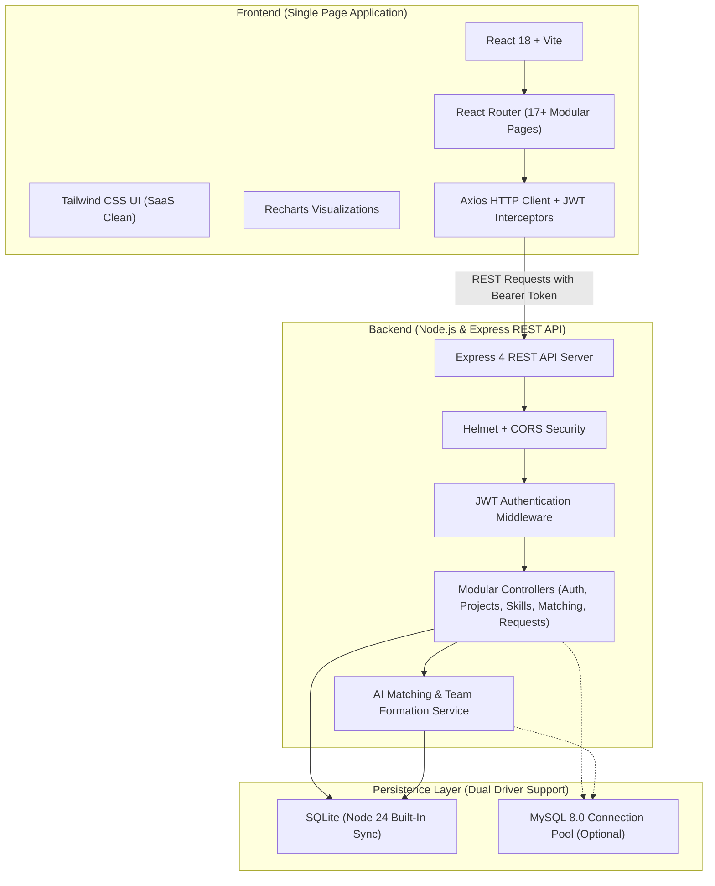

# SmartTeamFoundation — System Architecture

## 1. Architectural Overview

SmartTeamFoundation is built using a modern decoupled client-server architecture designed for high scalability, real-time feedback, and ease of demonstration.

---

## 2. Component Layers

### 2.1 Presentation Layer (Frontend)
- **Framework:** React 18 with Vite for ultra-fast compilation and HMR (Hot Module Replacement).
- **Styling:** Tailwind CSS with custom navy (`#0f172a`), brand blue (`#0267b5`), and subtle neutrals following SaaS design standards.
- **Routing:** React Router v6 managing 17 distinct pages:
  - Landing Page (`/`)
  - Login Page (`/login`)
  - Register Page (`/register`)
  - Student Dashboard (`/dashboard`)
  - Public Student Profile (`/profile/:id`)
  - Profile & Skills Editor (`/profile/edit`)
  - Project Discovery (`/projects`)
  - Project Details (`/projects/:id`)
  - Create Project (`/projects/create`)
  - Edit Project (`/projects/:id/edit`)
  - My Projects (`/my-projects`)
  - Team Members Roster (`/projects/:id/team`)
  - AI Teammate Recommendations (`/projects/:id/recommendations`)
  - Skill Gap Analysis (`/projects/:id/skill-gap`)
  - Team Management & Roster Approval (`/projects/:id/manage`)
  - Notifications & Invitations (`/notifications`)
  - Application & Algorithm Settings (`/settings`)
  - Teammate Discovery (`/teammates`)
- **State Management:** React Context API (`AuthContext`) maintaining authentication tokens, user profile metadata, and session status across route transitions.
- **Visualizations:** Recharts for skill proficiency distribution charts, project activity feeds, and skill gap breakdown donuts.

---

### 2.2 Application & Business Logic Layer (Backend)
- **Runtime:** Node.js v24 LTS.
- **Framework:** Express.js REST API.
- **Security:**
  - `bcryptjs`: 10-round salted password hashing.
  - `jsonwebtoken` (JWT): Signed Bearer token authentication with configurable expiration.
  - `helmet`: HTTP header hardening.
  - `cors`: Cross-Origin Resource Sharing control.
- **Service Modules:**
  - `matchingService.js`: Pure mathematical and explainable implementation of multi-attribute weighted matching, real-time team skill gap analysis, and greedy team composition selection.
  - Centralized Error Handler & 404 Handler preventing stack trace leakages in production.

---

### 2.3 Data Persistence Layer
- **Default Database:** Embedded SQLite via Node 24 native `node:sqlite` (`DatabaseSync`), storing data in `./backend/data/smartteam.sqlite`. Guarantees immediate zero-setup execution without requiring external database server configuration.
- **Enterprise Database:** MySQL 8.0 support enabled via `DB_CLIENT=mysql` and connection pooling in `backend/src/config/db.js`.
- **Relational Integrity:** Foreign key constraints with cascading deletes (`ON DELETE CASCADE`), unique compound indexes to prevent duplicate skill assignments or duplicate active team join requests.
