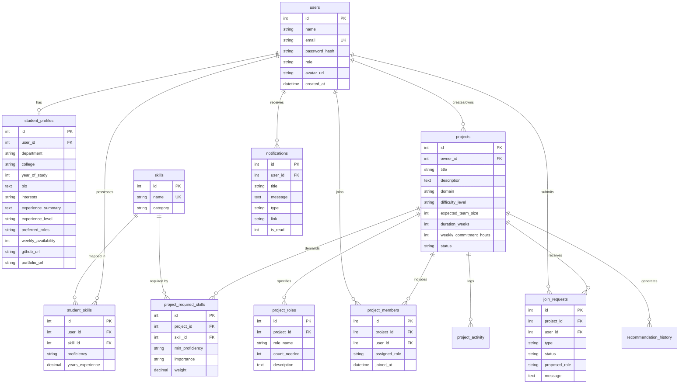

# SmartTeamFoundation — Database Schema & Data Dictionary

## 1. Entity-Relationship (ER) Diagram

---

## 2. Table Specifications & Constraints

### 2.1 `users`
| Column | Type | Constraints | Description |
| :--- | :--- | :--- | :--- |
| `id` | INTEGER | PRIMARY KEY, AUTO_INCREMENT | Unique user identifier |
| `name` | VARCHAR(150) | NOT NULL | Student's full name |
| `email` | VARCHAR(191) | NOT NULL, UNIQUE, INDEX | College email address |
| `password_hash` | VARCHAR(255) | NOT NULL | Bcrypt salted hash (10 rounds) |
| `role` | VARCHAR(50) | DEFAULT 'student' | Role (`student`, `coordinator`, `admin`) |
| `avatar_url` | VARCHAR(255) | NULL | Profile image link |
| `created_at` | DATETIME | DEFAULT CURRENT_TIMESTAMP | Account creation timestamp |
| `updated_at` | DATETIME | DEFAULT CURRENT_TIMESTAMP | Last modified timestamp |

### 2.2 `student_profiles`
| Column | Type | Constraints | Description |
| :--- | :--- | :--- | :--- |
| `id` | INTEGER | PRIMARY KEY, AUTO_INCREMENT | Profile primary key |
| `user_id` | INTEGER | UNIQUE, FK `users(id)` ON DELETE CASCADE | 1-to-1 mapping with `users` |
| `department` | VARCHAR(150) | NULL | Major / Academic branch |
| `college` | VARCHAR(200) | NULL | College or institute name |
| `year_of_study`| INTEGER | DEFAULT 3 | 1st to 4th year |
| `bio` | TEXT | NULL | Personal introduction & background |
| `interests` | TEXT | NULL | Comma-separated domain interests |
| `experience_summary` | TEXT | NULL | Prior hackathon / project summary |
| `experience_level` | VARCHAR(50) | DEFAULT 'Intermediate' | `Beginner`, `Intermediate`, `Advanced` |
| `preferred_roles` | TEXT | NULL | Preferred project team roles |
| `weekly_availability` | INTEGER | DEFAULT 10 | Hours available per week |
| `github_url` | VARCHAR(255) | NULL | GitHub profile URL |
| `portfolio_url` | VARCHAR(255) | NULL | Portfolio website URL |

### 2.3 `skills` & `student_skills`
- **`skills`:** Master technical catalog containing standard industry skill names and categories (`Frontend`, `Backend`, `Database`, `AI/ML`, `DevOps`, `Mobile`, `UI/UX`).
- **`student_skills`:** Many-to-many relationship mapping student competencies with specific proficiency tiers (`Beginner`, `Intermediate`, `Advanced`, `Expert`) and years of experience. Compound unique constraint `UNIQUE(user_id, skill_id)` strictly prohibits duplicate entries.

### 2.4 `projects` & `project_required_skills`
- **`projects`:** Stores project title, domain, expected team size, duration, weekly commitment hours, status (`Open`, `In Progress`, `Completed`, `Archived`), and project owner reference.
- **`project_required_skills`:** Links projects to required competencies with minimum required proficiency, importance classification (`Required`, `Preferred`, `Nice to have`), and weight. Compound unique constraint `UNIQUE(project_id, skill_id)`.

### 2.5 `project_members` & `join_requests`
- **`project_members`:** Confirmed team roster. Compound unique constraint `UNIQUE(project_id, user_id)` guarantees no duplicate memberships.
- **`join_requests`:** Application and invitation pipeline with statuses: `pending`, `accepted`, `rejected`. Capacity enforcement logic prevents accepting members when `current_count >= expected_team_size`.
